<div align="center">

# Jorge Troncoso · Portafolio

**Construyo software que conecta datos, procesos e inteligencia artificial local y en la nube.**

Desarrollo web · IA local y en la nube · RAG · Desarrollo agéntico

[](https://astro.build)
[](https://www.typescriptlang.org)
[](https://tailwindcss.com)
[](https://pages.cloudflare.com)
[](.nvmrc)
[](https://github.com/yorsh98)

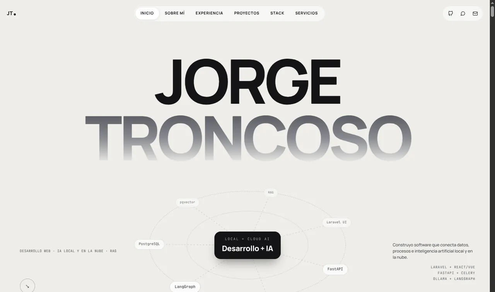

</div>

---

## Qué es esto

Un portafolio **100 % estático**, construido con Astro y publicado en Cloudflare Pages. Funciona como un recorrido continuo guiado por el scroll: el hero se encoge hasta convertirse en una tarjeta, la experiencia avanza en paneles horizontales, los proyectos giran en un carrusel curvo y cada sección aparece con una animación propia.

No usa servidor, base de datos ni SSR: todo el contenido vive en archivos TypeScript y se compila en `dist/`.

## Recorrido

| | Sección | Qué ocurre |
|:-:|---|---|
| 01 | **Inicio** | Nombre en gran formato y un diagrama orbital del stack: al pasar el mouse por un nodo, se detiene y muestra el detalle. |
| 02 | **Qué hago** | El hero se encoge hasta ser una tarjeta, las palabras se separan y aparece la presentación bajo un haz de luz; un barrido claro lleva a Proyectos. |
| 03 | **Proyectos** | Carrusel curvo de casos destacados, cada uno con su página de caso de estudio. |
| 04 | **Obras** | Un hexágono de tarjetas que se transforma en un tambor 3D; se puede arrastrar. |
| 05 | **Servicios** | Acordeón con entrada alternada y una pausa breve para leerlo antes de seguir. |
| 06 | **Stack** | Tecnologías por categoría, con logos que entran uno a uno y un título que se desplaza con el scroll. |
| 07 | **IA local y en la nube** | Tipos de modelos y capas de la infraestructura, revelados en secuencia. |
| 08 | **Experiencia** | Entrada con línea de luz; paneles horizontales con hitos en cascada y un barrido claro hacia Formación. |
| 09 | **Cursos y diplomados** | Galería horizontal fijada con curva 3D; en móvil, scroll horizontal nativo. |
| 10 | **Sobre mí** | Título que se enfoca al entrar y se desenfoca al salir, trayectoria que se dibuja y método de trabajo. |
| 11 | **Contacto** | Letras que suben una a una, foco de luz que sigue al cursor y firma que se enfoca al final. |

<table>
  <tr>
    <td width="50%">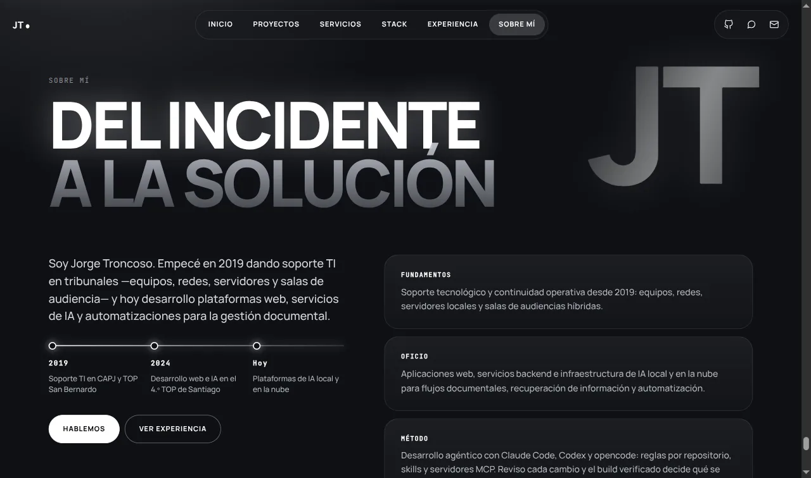</td>
    <td width="50%">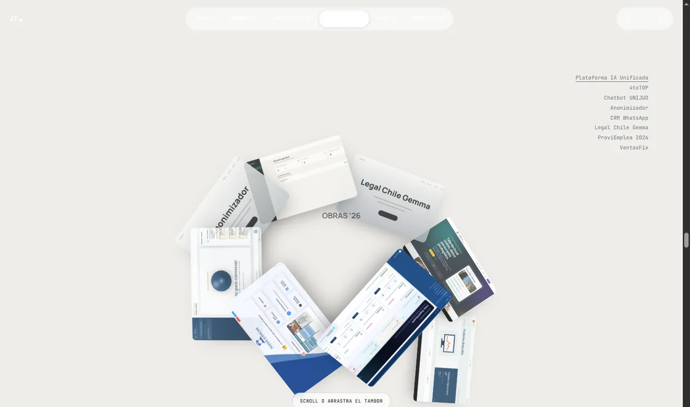</td>
  </tr>
  <tr>
    <td align="center"><sub><b>Sobre mí</b> · trayectoria y método</sub></td>
    <td align="center"><sub><b>Obras</b> · hexágono que se convierte en tambor</sub></td>
  </tr>
  <tr>
    <td width="50%">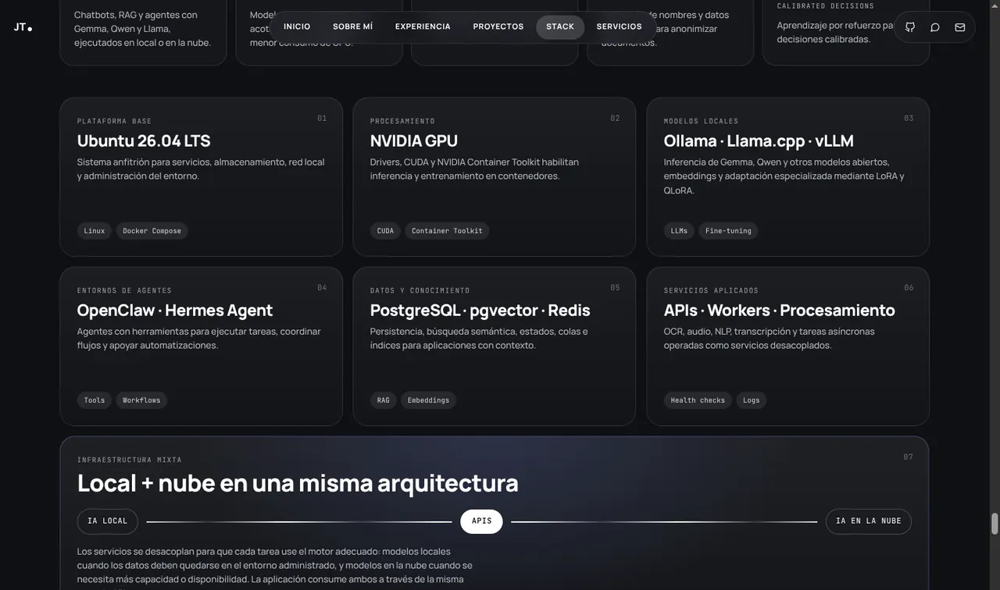</td>
    <td width="50%">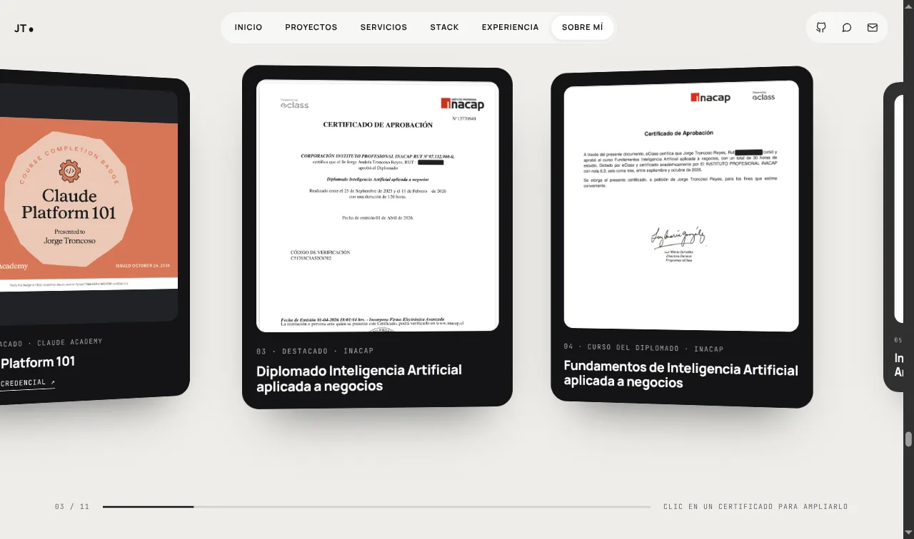</td>
  </tr>
  <tr>
    <td align="center"><sub><b>IA local y en la nube</b> · capas de la infraestructura</sub></td>
    <td align="center"><sub><b>Cursos y diplomados</b> · galería horizontal curva</sub></td>
  </tr>
</table>

> Todas las animaciones respetan `prefers-reduced-motion`: con esa preferencia activa, el contenido aparece sin movimiento.

## Casos de estudio

Cada proyecto tiene su página en `/proyectos/[slug]`, con problema, solución, arquitectura, infraestructura, galería y alcance de publicación.

| | Proyecto | Tipo | Stack principal |
|:-:|---|---|---|
| 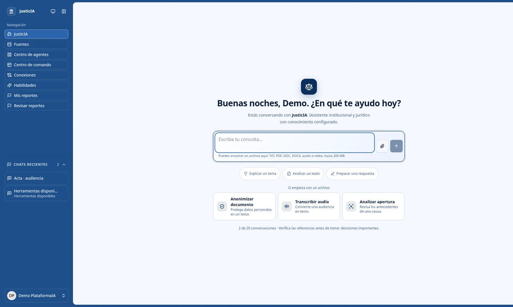 | **Plataforma IA JusticIA** | Desarrollo web + IA | Laravel · FastAPI · Ollama · LangGraph · pgvector |
| 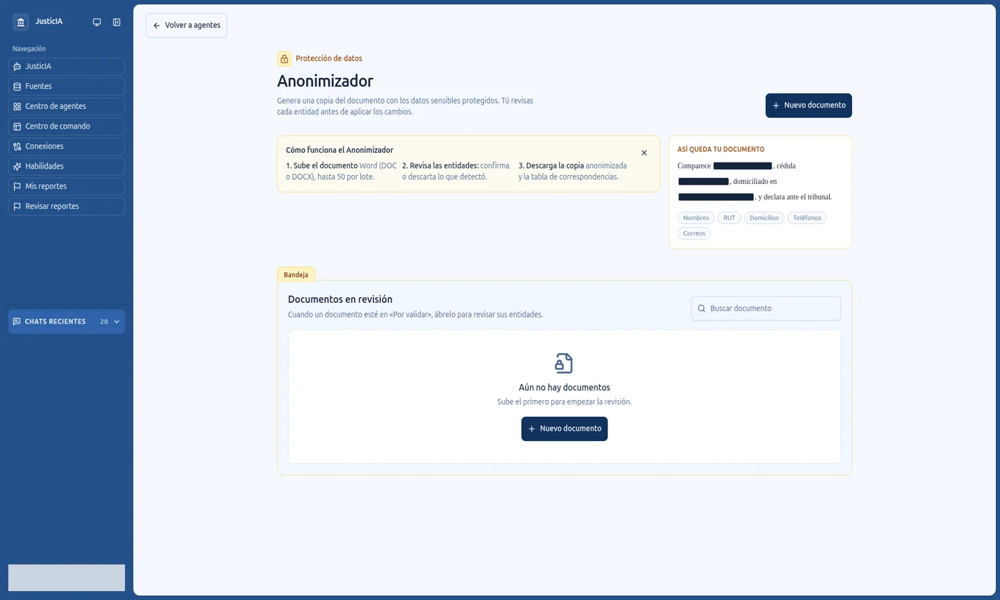 | **Anonimizador** | Desarrollo web + IA | Laravel · FastAPI · NER · Ollama |
| 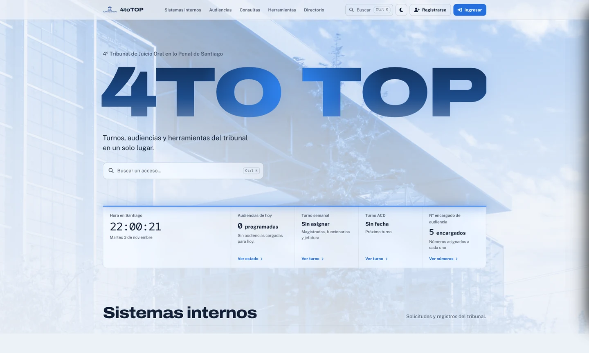 | **4toTOP** (V2, con botón para ver la V1) | Desarrollo web | Laravel · Livewire · Volt · MariaDB |
| 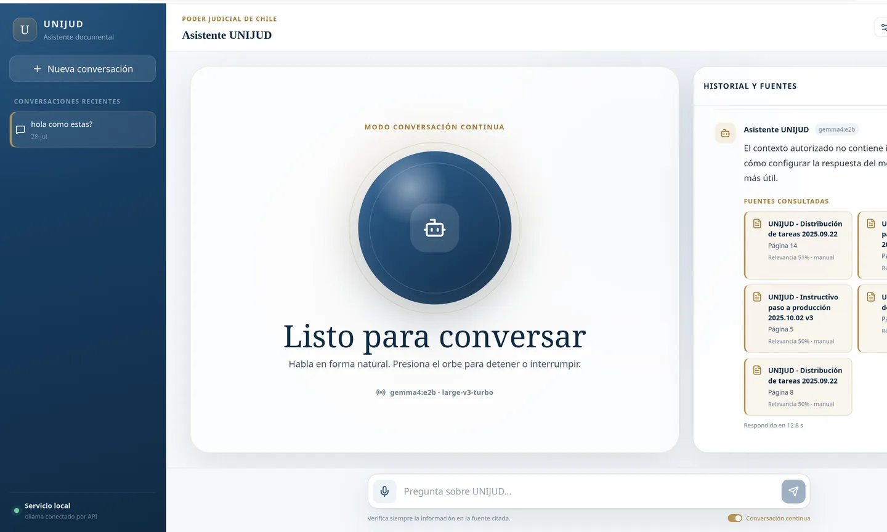 | **Chatbot UNIJUD** | RAG documental | Vue 3 · FastAPI · LangGraph · pgvector · Whisper |
| 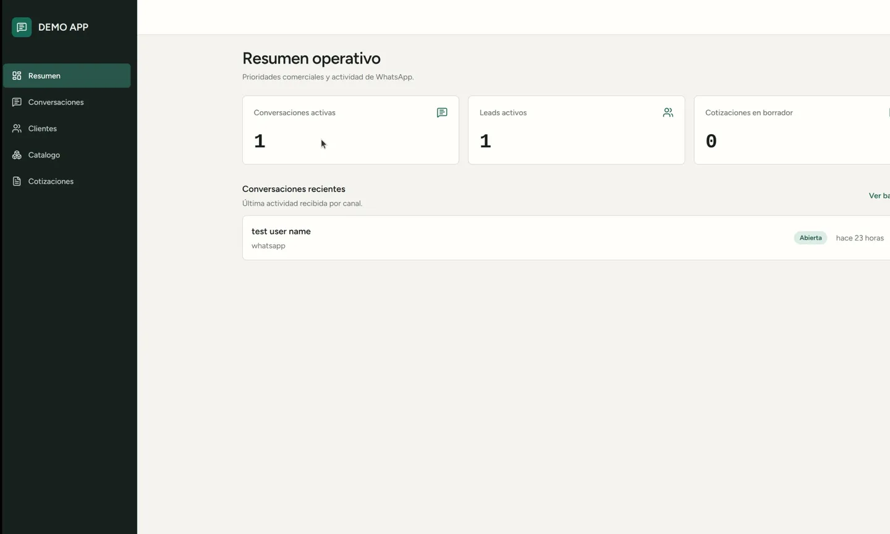 | **CRM comercial para WhatsApp** | Desarrollo web + IA | Laravel · React · FastAPI · WhatsApp Cloud API |
| 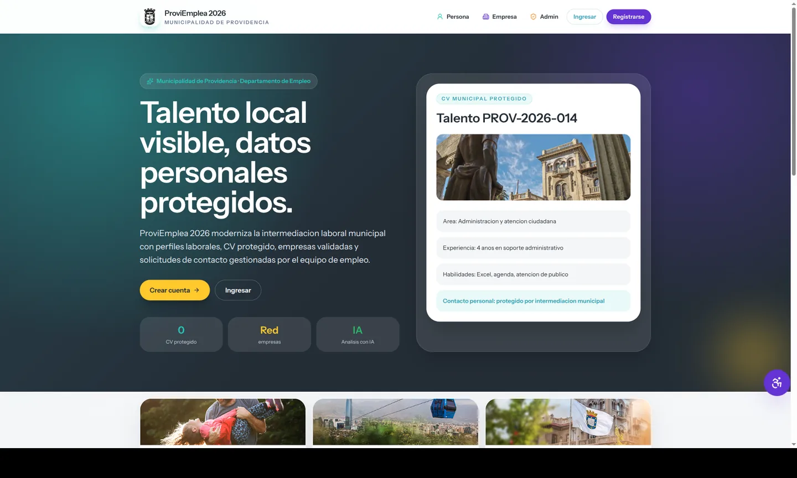 | **ProviEmplea 2026** | Proyecto académico | Laravel API · React · Inertia · MySQL · Docker |
| 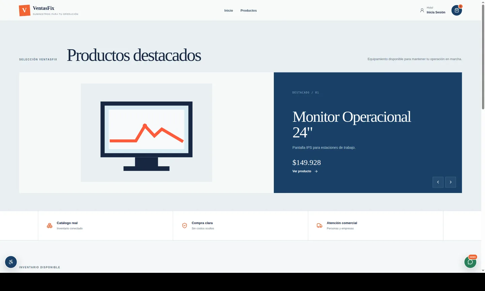 | **VentasFix** | Proyecto académico | React · FastAPI · PostgreSQL · Redis · Docker |
| — | **Legal Chile Gemma** | Modelo fine-tuneado | Gemma · LoRA / QLoRA · Transformers · PEFT |

Los proyectos privados se presentan anonimizados: las capturas pasan por una revisión para excluir nombres, números de causa, correos y cualquier dato sensible.

## Cómo está construido

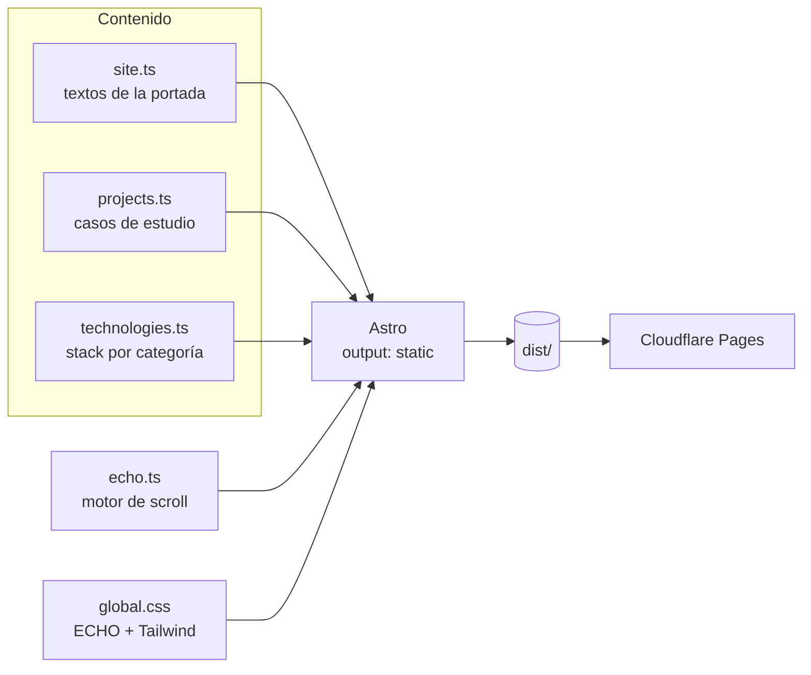

- **Astro 7** con salida estática y view transitions nativas entre páginas.
- **TypeScript estricto** en datos, scripts y componentes.
- **Tailwind CSS 4** junto a una hoja de estilos propia con el sistema visual ECHO.
- **Logos de Simple Icons** incrustados como SVG en tiempo de build, sin peticiones externas.
- **Un único motor de animación** (`echo.ts`) que coordina las escenas fijadas, el carrusel, el tambor y las apariciones al hacer scroll.

<details>
<summary><b>Estructura del repositorio</b></summary>

```text
src/
├── data/
│   ├── site.ts            Contenido de la portada: textos, enlaces e imágenes
│   ├── projects.ts        Casos de estudio y sus galerías
│   └── technologies.ts    Stack por categoría
├── layouts/
│   └── BaseLayout.astro   Head, navegación y metadatos
├── pages/
│   ├── index.astro        Portada con todas las secciones
│   └── proyectos/
│       └── [slug].astro   Página de caso de estudio
├── scripts/
│   └── echo.ts            Motor de animación por scroll
└── styles/
    └── global.css         Estilos ECHO + Tailwind

public/images/             Capturas en WebP (proyectos, certificados, portadas)
portfolio-echo-kit/        Kit original de referencia (brief, scrum y demo vanilla)
.claude/skills/            Skill que guía la edición del contenido
AGENTS.md                  Reglas para los agentes que trabajan en el repo
```

</details>

## Desarrollo agéntico

Este repositorio también es un ejemplo del método que muestra el portafolio. Se trabaja con agentes de código —**Claude Code, Codex y opencode**— apoyados en skills y servidores MCP, siempre bajo las mismas reglas:

- [`AGENTS.md`](AGENTS.md) fija el contrato: stack obligatorio, restricciones, criterios de diseño y reglas de publicación.
- Una skill propia ([`.claude/skills/portfolio-guide`](.claude/skills/portfolio-guide)) guía la edición del contenido.
- Cada cambio se revisa, y `npm run check && npm run build` decide si se entrega.

## Desarrollo local

Requiere **Node.js ≥ 22.23.4** (ver [`.nvmrc`](.nvmrc)).

```bash
npm install
npm run dev       # servidor de desarrollo en http://localhost:4321
npm run check     # verificación de tipos y plantillas
npm run build     # check + build estático en dist/
npm run preview   # sirve dist/ localmente
```

<details>
<summary><b>Agregar un proyecto nuevo</b></summary>

1. Convierte las capturas a **WebP** (1600×900 funciona bien) y revisa que no contengan datos sensibles.
2. Guárdalas en `public/images/projects/<slug>/`.
3. Agrega la entrada en `src/data/projects.ts`: objetivo, solución, arquitectura, infraestructura, nota de publicación y galería (cada imagen con `src` y `caption`).
4. Si debe aparecer en la portada, súmalo a `featured` u `works` en `src/data/site.ts`.
5. Ejecuta `npm run check && npm run build`.

</details>

## Publicación en Cloudflare Pages

| Ajuste | Valor |
|---|---|
| Framework preset | Astro |
| Build command | `npm run build` |
| Build output directory | `dist` |
| Node | versión de `.nvmrc` |

## Reglas de publicación

- Sin claves, tokens, IP privadas, credenciales, documentos institucionales ni datos personales.
- Sin métricas ni resultados que no tengan evidencia.
- Proyectos privados señalados y anonimizados.
- Capturas en WebP o AVIF, con texto alternativo y revisadas antes de publicarse.

---

<div align="center">
<sub>Hecho con Astro · Santiago, Chile · <a href="https://github.com/yorsh98">@yorsh98</a></sub>
</div>
